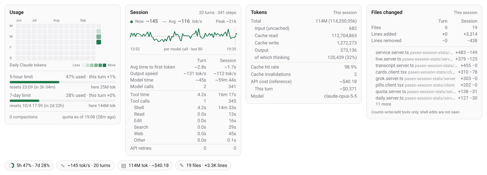

# paseo-stats

A [Paseo](https://paseo.sh) plugin that puts four stat pills above the composer of every Claude Code and Grok agent. Click a pill for a card with details. It reads local files only and never makes a network request.

[中文说明](README.zh-CN.md)



## What it shows

| Pill | Card |
|---|---|
| `5h 47% · 7d 28%` with a ring for the first window | **Usage**: daily token heatmap (last 16 weeks), quota bars, reset time, quota used by the last turn, tokens spent in each window on this machine, compaction count, age of the quota reading |
| `~145 tok/s · 20 turns` (latest call's speed) | **Session**: output speed per call (curve with current / average / peak), time to first token, model time, tool time by category, model calls, API retries, each for the latest turn and the whole session |
| `114M tok · ~$40.18` | **Tokens**: total, uncached input, cache read / write, output, thinking share, cache hit rate, cache invalidations, cost for the session and the latest turn, model. Grok sessions add output smoothness and stability counters |
| `19 files · +3.3K lines` | **Files changed**: files written or edited and lines added / removed (latest turn and session), most-changed files first |

Values starting with `~` are estimates. `—` means the value could not be measured; the row stays visible. Labels follow the app's language (Chinese for `zh*`, English otherwise).

## Supported agents

| Agent | Session data | Quota |
|---|---|---|
| Claude Code | `~/.claude/projects/**/<session>.jsonl` (`CLAUDE_CONFIG_DIR` honoured, several dirs allowed) | 5-hour and 7-day windows, via usage-monitor |
| Grok CLI (Grok Build) | `~/.grok/sessions/<cwd>/<session>/` — `usage.json`, `events.jsonl`, `signals.json`, `updates.jsonl` (`GROK_HOME` honoured) | SuperGrok weekly pool, via usage-monitor |

Paseo's live event stream adds what the logs do not have: when each Claude call started streaming (for speed and time to first token), approval waits, and the context window.

## Install

Requires Paseo 0.9 or newer. Tested with daemon 0.10.1 and app 0.9.1.

```sh
paseo plugin install https://github.com/HaosuStrasbourg/paseo-stats
# or from a local checkout
paseo plugin install /path/to/paseo-stats
```

No daemon restart is needed; the pills appear after the app reloads its plugins.

### Quotas (optional)

Quota numbers come from the [usage-monitor](https://github.com/ABorakati/paseo-usage-monitor) plugin's cache (`$PASEO_HOME/usage-limits/last-readings.json`). This plugin only reads that file. Without usage-monitor, the quota rows read "no quota data" and everything else works.

The entry is found by its `preset` in `$PASEO_HOME/usage-limits.json`, so the entry name does not matter. Claude works with the stock `claude` preset.

For Grok, the stock `grok` preset reads a legacy monthly endpoint that returns zeros for subscriptions, and cannot read the credential format of Grok CLI 1.0+. Override it in `usage-limits.json`:

```json
"grok": {
  "preset": "grok",
  "refreshIntervalMs": 1800000,
  "source": {
    "kind": "http",
    "url": "https://cli-chat-proxy.grok.com/v1/billing?format=credits",
    "method": "GET",
    "headers": { "Authorization": "Bearer ${token}", "X-XAI-Token-Auth": "xai-grok-cli", "Accept": "application/json" }
  },
  "readings": [{
    "kind": "quota", "id": "weekly", "label": "Weekly", "unit": "percent",
    "percentPath": "creditUsagePercent",
    "window": { "label": "Weekly", "resetsAtPath": "config.currentPeriod.end", "durationMs": 604800000 }
  }],
  "credentials": {
    "token": [{
      "kind": "jsonFile",
      "file": "~/.grok/auth.json",
      "path": "[\"<scope key in your auth.json>\"].key",
      "expiresAtPath": "[\"<scope key in your auth.json>\"].expires_at",
      "refreshedBy": "grok"
    }]
  }
}
```

The scope key is the top-level key of `~/.grok/auth.json` (an `https://auth.x.ai::…` string). Grok omits `creditUsagePercent` at 0%; this plugin reads a weekly period without it as 0%.

### Running Grok in Paseo

Grok CLI speaks ACP. Add it as a custom provider in `$PASEO_HOME/config.json`, then run `paseo reload`:

```json
"agents": {
  "providers": {
    "grok": { "extends": "acp", "label": "Grok", "command": ["/home/you/.grok/bin/grok", "agent", "stdio"] }
  }
}
```

## How the numbers are computed

- **Turns**: real user prompts (not tool results, slash-command echoes or interrupt markers). **Steps**: model calls, deduplicated by `message.id` (Claude writes one entry per content block).
- **Total tokens**: uncached input + cache read + cache write + output. Grok reports input including cache, so cache is subtracted first. **Cache hit rate**: cache read ÷ (uncached input + cache read + cache write).
- **Cache invalidation** (Claude): the previous call left at least 10k tokens cached, this call read under 50% of it and wrote at least 50% of it again. The first call after a compaction is skipped. Grok has no per-call cache data, so it shows `—`.
- **Output speed** (Claude, per call): output tokens ÷ (last block written − streaming start). The start is the first live usage update after the request went out; if none was seen, or it arrived late (Paseo sometimes delivers a whole call's events at its end), the request time is used, which can only understate the speed. Calls under 200 ms or above 1,000 tok/s are left out.
- **Output speed** (Grok, per turn): Grok reports output tokens per turn only, so speed is turn output ÷ streaming time (first token to end of each call, including reasoning). Turns under 200 ms of streaming or above 2,000 tok/s are left out.
- **Time to first token**: Claude, request sent → streaming start (live only, so earlier history shows `—`); Grok, waiting for model → first token, from `events.jsonl`.
- **Model time** (Claude): per call, from the previous event to its last block, excluding time lost to failed attempts before an API retry. Grok: per call from `events.jsonl`.
- **Tool time**: tool start → result, minus time waiting for approval. Grok's `duration_ms` already excludes it.
- **Cost**: Claude is priced from the LiteLLM rate table that usage-monitor caches locally (reference only; compaction calls are not in the transcript). Grok's own figure from `usage.json`.
- **Quota used by the last turn**: reading after the turn ends minus the reading at turn start. `—` if the window reset or no new reading arrived within 90 s.
- **Tokens in a quota window**: all sessions of that agent on this machine since `reset time − window length`, deduplicated.
- **Files changed**: only successful write/edit tool calls. Claude counts `+`/`-` lines of the structured patch (a new file counts all its lines); Grok compares the before/after text of each diff. Files are counted once per path.
- **Heatmap**: daily totals in the host's time zone, five tiers by rank among days with data. Totals are kept in `$PASEO_HOME/paseo-stats/daily.json` and never lowered, so they survive Claude Code deleting transcripts after 30 days.

## Privacy and request volume

This plugin reads local files and Paseo's local event stream. It sends nothing anywhere. Quota readings are fetched by usage-monitor: one request per provider at the end of each turn, cached 30 minutes, with backoff on HTTP 429.

## Known limits

- Counts this machine only. Quotas are per account, so usage on other devices is not in the "this machine" token figures.
- Shell edits (`sed`, scripts, redirects) and sub-agent work are not counted as file changes.
- Reads internal file formats of usage-monitor, Paseo (`agents/*.json`, as a fallback) and Grok CLI, which may change.
- Live data (speed start, time to first token, approval waits) exists only while the plugin runs.
- The composer may not fit four pills on very narrow screens.

## Development

```sh
npm install          # dev dependencies, for type checking only
npm run typecheck
npm run stats -- <claude-session-id>   # print transcript metrics and daily totals
```

State lives in `$PASEO_HOME/paseo-stats/` (`daily.json`, `live/<agent>.json`).

## License

MIT
