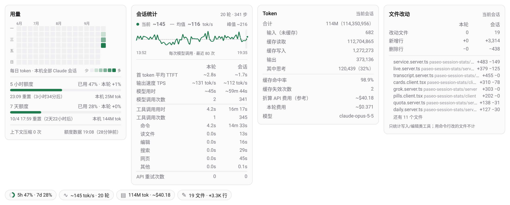

# paseo-stats

一个 [Paseo](https://paseo.sh) 插件：在每个 Claude Code 和 Grok 会话的输入框上方显示四个统计胶囊，点开是详情卡片。只读本地文件，不发任何网络请求。

[English](README.md)



## 显示什么

| 胶囊 | 卡片 |
|---|---|
| `5h 47% · 7d 28%`，圆环表示第一个额度窗口 | **用量**：每日 token 热力图（最近 16 周）、额度进度条、重置时间、上一轮消耗的额度、本机在各窗口内用掉的 token、上下文压缩次数、额度数据时间 |
| `~145 tok/s · 20 轮`（最近一次调用的速度） | **会话统计**：每次调用的输出速度曲线（当前 / 均值 / 峰值）、首 token 时间、模型用时、按类型拆分的工具用时、模型调用次数、API 重试次数，分"本轮"和"会话"两列 |
| `114M tok · ~$40.18` | **Token**：合计、输入（未缓存）、缓存读 / 写、输出、思考占比、缓存命中率、缓存失效次数、会话和本轮费用、模型。Grok 会话另有输出流畅度和稳定性指标 |
| `19 文件 · +3.3K 行` | **文件改动**：通过文件工具写入或编辑的文件数、新增 / 删除行数（本轮和会话），按改动量列出文件 |

带 `~` 的是估算值。测不到的显示 `—`，该行不隐藏。界面语言跟随应用语言：`zh*` 显示中文，其他显示英文。

## 支持的 agent

| Agent | 会话数据 | 额度 |
|---|---|---|
| Claude Code | `~/.claude/projects/**/<会话>.jsonl`（支持 `CLAUDE_CONFIG_DIR`，可配多个目录） | 5 小时和 7 天窗口，经 usage-monitor |
| Grok CLI（Grok Build） | `~/.grok/sessions/<目录>/<会话>/` 下的 `usage.json`、`events.jsonl`、`signals.json`、`updates.jsonl`（支持 `GROK_HOME`） | SuperGrok 每周额度池，经 usage-monitor |

Paseo 的实时事件补充日志里没有的信息：Claude 每次调用开始吐字的时刻（用于速度和首 token 时间）、等待批准的时间、上下文用量。

## 安装

需要 Paseo 0.9 及以上。已在 daemon 0.10.1、应用 0.9.1 上验证。

```sh
paseo plugin install https://github.com/HaosuStrasbourg/paseo-stats
# 或从本地目录安装
paseo plugin install /path/to/paseo-stats
```

不用重启 daemon，应用重新加载插件后胶囊就会出现。

### 额度（可选）

额度数据读自 [usage-monitor](https://github.com/ABorakati/paseo-usage-monitor) 插件的缓存（`$PASEO_HOME/usage-limits/last-readings.json`），本插件只读这个文件。没装 usage-monitor 时，额度一栏显示"无额度数据"，其他功能不受影响。

插件按 `preset` 在 `$PASEO_HOME/usage-limits.json` 里找条目，条目叫什么名字都可以。Claude 用默认的 `claude` 预设即可。

Grok 默认的 `grok` 预设请求的是旧的月度接口（订阅用户返回 0），也读不了 Grok CLI 1.0 以上的凭据格式。需要在 `usage-limits.json` 里覆盖：

```json
"grok": {
  "preset": "grok",
  "refreshIntervalMs": 1800000,
  "source": {
    "kind": "http",
    "url": "https://cli-chat-proxy.grok.com/v1/billing?format=credits",
    "method": "GET",
    "headers": { "Authorization": "Bearer ${token}", "X-XAI-Token-Auth": "xai-grok-cli", "Accept": "application/json" }
  },
  "readings": [{
    "kind": "quota", "id": "weekly", "label": "Weekly", "unit": "percent",
    "percentPath": "creditUsagePercent",
    "window": { "label": "Weekly", "resetsAtPath": "config.currentPeriod.end", "durationMs": 604800000 }
  }],
  "credentials": {
    "token": [{
      "kind": "jsonFile",
      "file": "~/.grok/auth.json",
      "path": "[\"<auth.json 里的授权范围键名>\"].key",
      "expiresAtPath": "[\"<auth.json 里的授权范围键名>\"].expires_at",
      "refreshedBy": "grok"
    }]
  }
}
```

授权范围键名是 `~/.grok/auth.json` 的顶层键（形如 `https://auth.x.ai::…`）。用量为 0% 时 Grok 不返回 `creditUsagePercent`，本插件在确认处于有效周期时按 0% 显示。

### 在 Paseo 里运行 Grok

Grok CLI 支持 ACP 协议。在 `$PASEO_HOME/config.json` 里加一个自定义 provider，然后执行 `paseo reload`：

```json
"agents": {
  "providers": {
    "grok": { "extends": "acp", "label": "Grok", "command": ["/home/you/.grok/bin/grok", "agent", "stdio"] }
  }
}
```

## 指标口径

- **轮数**：真实的用户消息（不含工具结果、斜杠命令回显、中断标记）。**步数**：模型调用次数，按 `message.id` 去重（Claude 每个内容块写一条记录）。
- **总 token**：未缓存输入 + 缓存读 + 缓存写 + 输出。Grok 的输入包含缓存，先扣掉。**缓存命中率**：缓存读 ÷（未缓存输入 + 缓存读 + 缓存写）。
- **缓存失效**（Claude）：上一次调用留下的缓存 ≥ 1 万 token，本次读到的不足一半、重新写入不少于一半。压缩后的第一次调用不算。Grok 没有单次调用的缓存数据，显示 `—`。
- **输出速度**（Claude，按调用）：输出 token ÷（最后一个内容块写入 − 开始吐字）。开始时刻取请求发出后收到的第一次实时用量更新；没收到或来得太晚（Paseo 有时会在调用结束时一次性推送全部事件）就用请求发出时刻，这样只会低估。不足 200 毫秒或超过 1,000 tok/s 的调用不计。
- **输出速度**（Grok，按轮）：Grok 只按轮记录输出 token，速度 = 本轮输出 ÷ 流式输出时长（每次调用从首 token 到结束，含推理阶段）。流式时长不足 200 毫秒或超过 2,000 tok/s 的轮不计。
- **首 token 时间**：Claude 是请求发出 → 开始吐字（只有插件运行期间有数据，之前的历史显示 `—`）；Grok 是开始等待模型 → 首 token，取自 `events.jsonl`。
- **模型用时**（Claude）：每次调用从上一个事件到最后一个内容块，剔除 API 重试前失败尝试耗费的时间。Grok 按 `events.jsonl` 逐次计算。
- **工具用时**：工具开始 → 返回结果，扣除等待批准的时间。Grok 的 `duration_ms` 本身已不含等待。
- **费用**：Claude 按 usage-monitor 本地缓存的 LiteLLM 价格表折算，仅供参考（压缩那次调用不在会话记录里，不计入）。Grok 用 `usage.json` 里它自己算的值。
- **上一轮消耗的额度**：本轮结束后的读数 − 本轮开始时的读数。窗口重置过、或 90 秒内没等到新读数时显示 `—`。
- **额度窗口内的 token**：本机该 agent 所有会话在"重置时间 − 窗口长度"之后的 token，去重后合计。
- **文件改动**：只算执行成功的写入、编辑类工具。Claude 数结构化差异里的 `+` / `-` 行（新建文件按全部行数计）；Grok 比较每次修改前后的文本。同一文件按路径只算一个。
- **热力图**：按本机时区分天，在有数据的天里按排名分 5 档。每日合计存在 `$PASEO_HOME/paseo-stats/daily.json`，只增不减，Claude Code 30 天后删除会话记录也不受影响。

## 隐私与请求频率

本插件只读本地文件和 Paseo 本地的事件流，不向任何地方发送数据。额度由 usage-monitor 获取：每轮结束时每个 provider 请求一次，缓存 30 分钟，遇到 HTTP 429 会自动退避。

## 已知限制

- 只统计本机。额度按账号计算，其他设备上的用量不会出现在"本机"的 token 数里。
- 用命令行改的文件（`sed`、脚本、重定向）和子代理的改动，不计入文件改动。
- 依赖 usage-monitor、Paseo（`agents/*.json`，仅作兜底）和 Grok CLI 的内部文件格式，它们升级时可能变化。
- 实时数据（开始吐字时刻、首 token 时间、批准等待）只有插件运行期间才有。
- 屏幕很窄时，输入框上方可能放不下四个胶囊。

## 开发

```sh
npm install          # 仅用于类型检查的开发依赖
npm run typecheck
npm run stats -- <claude-会话ID>   # 打印会话记录统计和每日合计
```

插件状态存放在 `$PASEO_HOME/paseo-stats/`（`daily.json`、`live/<agent>.json`）。

## 许可证

MIT
